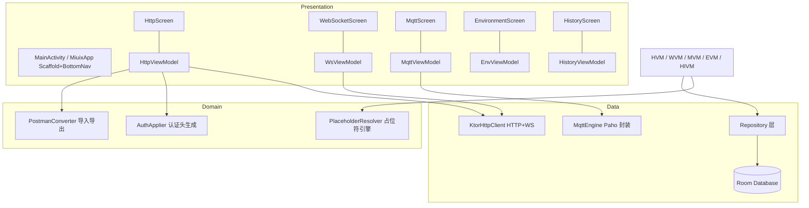
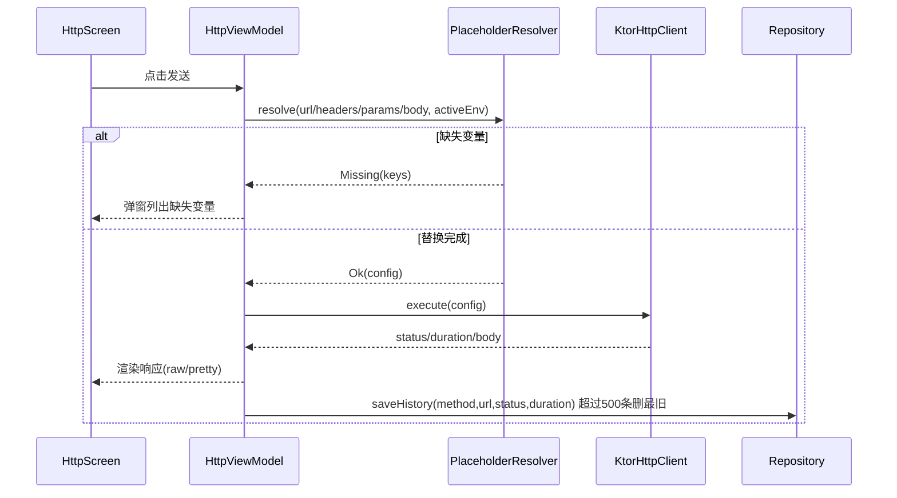

# API Tester 技术设计

Feature Name: api-tester
Updated: 2026-09-28
Status: Draft

## Description

Android 单端 API 调试工具，UI 层使用 Jetpack Compose + Miuix（HyperOS/MIUI 设计语言），功能覆盖 HTTP 调试、WebSocket 会话测试、MQTT 订阅发布，配合环境变量系统与 Room 持久化。单 Activity 架构，底部导航切换五个主页面。

## 技术栈

| 类别 | 选型 | 版本基准 | 说明 |
|------|------|---------|------|
| 语言 | Kotlin | 2.1+ | Compose Compiler 随 Kotlin 插件 |
| UI | Jetpack Compose | 最新稳定 BOM | 单 Activity |
| UI 库 | Miuix `top.yukonga.miuix.kmp:miuix-ui-android` | 0.9.x | Scaffold、NavigationBar、Dialog、TextField 等；可选加 `miuix-icons` |
| HTTP + WebSocket | Ktor Client 3.x（okhttp 引擎） | 3.x | 一套客户端同时覆盖 HTTP 与 WS，WS 底层即 OkHttp |
| MQTT | Eclipse Paho `org.eclipse.paho.client.mqttv3` | 1.2.5 | 纯 Java 库，进程内 `MqttAsyncClient`，协程封装为 Flow |
| 数据库 | Room | 2.8.x | 实体 + DAO + TypeConverter |
| 偏好 | DataStore Preferences | 1.1.x | 保存激活环境 ID、UI 偏好 |
| 序列化 | kotlinx.serialization | 1.9.x | 请求体 JSON、Postman 导入导出、DB 字段编码 |
| 异步 | 协程 + StateFlow/SharedFlow | - | 全部 ViewModel 走 viewModelScope |

## Architecture



分层规则：

1. **Presentation**：Compose 界面 + ViewModel，ViewModel 之间零依赖，激活环境变化通过 Repository 的 StateFlow 广播。
2. **Domain**：纯 Kotlin 无 Android 依赖，PlaceholderResolver、PostmanConverter、AuthApplier 均为无状态对象，可独立单测。
3. **Data**：Room 数据源、Ktor 客户端单例、Paho 封装。网络层向外只暴露挂起函数与 Flow。

### 组件接口定义

```kotlin
// 占位符引擎：返回替换结果或缺失变量列表
interface PlaceholderResolver {
    fun resolve(text: String, vars: Map<String, String>): ResolveResult
    sealed interface ResolveResult {
        data class Ok(val resolved: String) : ResolveResult
        data class Missing(val keys: List<String>) : ResolveResult
    }
}

// HTTP 引擎
interface HttpEngine {
    suspend fun execute(config: HttpCallConfig): HttpCallResult
}

// WebSocket 引擎
interface WsEngine {
    val events: SharedFlow<WsEvent>   // Connected / TextReceived / Sent / Closed(reason)
    suspend fun connect(config: WsConfig)
    suspend fun send(text: String)
    suspend fun close(reason: String? = null)
}

// MQTT 引擎
interface MqttEngine {
    val events: SharedFlow<MqttEvent> // Connected(latencyMs) / MessageReceived(topic,qos,payload) / Disconnected(reason) / Error(cause)
    suspend fun connect(config: MqttConfig)
    suspend fun subscribe(topic: String, qos: Int)
    suspend fun publish(topic: String, payload: String, qos: Int)
    suspend fun disconnect()
}
```

### HTTP 请求时序



## Components and Interfaces

### 页面组件（Miuix）

| 页面 | 主要组件 | 交互要点 |
|------|---------|---------|
| HttpScreen | 顶栏环境切换器(SuperArrow/PopupHost)、方法+URL 输入行、发送按钮(SendButton)、Tab 行(Params/Headers/Body/Auth)、键值对编辑卡、响应卡 | Body 类型选择驱动编辑器切换；发送中按钮变加载态且禁用；响应 JSON 切 raw/pretty |
| WebSocketScreen | 连接配置卡(URL/子协议/头)、状态徽标、连接/断开按钮、消息输入行、消息流 LazyColumn | 收/发消息左右分色+时间戳；连接后输入区启用 |
| MqttScreen | 连接配置卡(broker/clientId/用户名密码/KeepAlive)、订阅列表卡(Topic+QoS)、发布卡(Topic/负载/QoS)、消息流 | 消息条目显示 topic/qos/方向；连接失败显示具体错误 |
| EnvironmentScreen | 环境列表卡(激活开关)、变量编辑卡、新建环境入口 | 删除需 Miuix Dialog 二次确认 |
| HistoryScreen | 搜索框、历史列表卡(方法徽标/URL/状态码/耗时/时间)、详情跳转 | 点击载入 HttpScreen 编辑器；顶部"清空历史" |

### 导航

`MiuixApp` 使用 `Scaffold(bottomBar = NavigationBar)` + 5 个 `NavigationBarItem`，选中索引保存在 `rememberSaveable`；页面切换直接按索引渲染对应 Screen（规模小，无需 Navigation 库）。WebSocket/MQTT 会话状态放 ViewModel（`viewModel(factory)`，Activity 重建不丢会话引用）。

## Data Models

Room 实体（数组/对象字段经 `kotlinx.serialization` 编码为 TEXT 列）：

```mermaid
erDiagram
    Environment ||--o{ EnvironmentVariable : contains
    RequestCollection ||--o{ SavedRequest : contains
    WsSessionConfig ||--o{ WsMessage : has
    MqttSessionConfig ||--o{ MqttMessage : has

    Environment { int id PK, string name, bool isActive }
    EnvironmentVariable { int id PK, int envId FK, string key, string value }
    RequestCollection { int id PK, string name, int sortOrder }
    SavedRequest { int id PK, int collectionId FK, string name, string method, string url, string headersJson, string paramsJson, string bodyType, string body, string authType, string authJson, int createdAt }
    HttpHistory { int id PK, string method, string url, string headersJson, string paramsJson, string bodyType, string body, int statusCode, int durationMs, int responseSize, bool success, string errorMessage, int createdAt }
    WsSessionConfig { int id PK, string name, string url, string headersJson, string subprotocols }
    WsMessage { int id PK, int sessionId FK, int direction, string content, int timestamp }
    MqttSessionConfig { int id PK, string name, string brokerUrl, string clientId, string username, string password, int keepAliveSec }
    MqttMessage { int id PK, int sessionId FK, string topic, int direction, string payload, int qos, int timestamp }
```

要点：

1. **SavedRequest 与 HttpHistory 分离**：History 存完整请求快照，点击即可原样回放。
2. **清理策略落地**：HttpHistory 插入后执行 `DELETE FROM http_history WHERE id NOT IN (SELECT id ... ORDER BY createdAt DESC LIMIT 500)`；WsMessage/MqttMessage 同理按会话 LIMIT 1000。
3. **激活环境唯一性**：`isActive` 切换在 Repository 事务内"先清后设"，全局仅一个激活环境。
4. **级联删除**：envId/collectionId/sessionId 外键设置 `onDelete = CASCADE`。

### 占位符语法

正则 `\{\{\s*([A-Za-z_][A-Za-z0-9_]*)\s*\}\}`，应用于 URL、每个 header 值、每个 query 值、body 文本、WS 消息、MQTT payload。解析顺序：激活环境变量 → 全局未定义则 Missing。

### Postman v2.1 兼容

- **导入**：解析 `info.schema` 校验 → item 递归展开为文件夹 → request(method/url.raw/header[]/body) 映射 SavedRequest；url 中的 `{{var}}` 原样保留为占位符。
- **导出**：RequestCollection → folder，SavedRequest → item，生成符合 `https://schema.getpostman.com/json/collection/v2.1.0/` 的 JSON。
- 导入导出均通过 Android SAF（`ActivityResultContracts.CreateDocument / OpenDocument`）读写用户选定文件。

## Correctness Properties

1. 发送成功的请求配置中，任意 `{{var}}` 均已被替换，输出文本中残留占位符数量为 0。
2. 激活环境在任意时刻有且仅有一个。
3. HttpHistory 表行数 ≤ 500；任意 WsMessage/MqttMessage 会话行数 ≤ 1000。
4. 删除环境后，该环境变量数为 0；删除集合后，其内请求为 0。
5. 认证方式为 Bearer 时，实际发出的请求头 `Authorization` 值以 `Bearer ` 前缀开头；Basic 时为 `Basic Base64(user:pass)`。
6. 正在发送中的请求未结束前，发送按钮处于禁用状态（防重复提交）。
7. WsEngine/MqttEngine 断开后重新 connect 可恢复完整功能（状态机无残留）。
8. Postman 导入→导出 round-trip 后，方法、URL、header、body 类型保持一致。

## Error Handling

| 场景 | 检测点 | 用户可见行为 |
|------|--------|-------------|
| 占位符缺失变量 | 发送前 resolve | Miuix Dialog 列出缺失变量名，可跳转环境页 |
| HTTP 连接超时 | Ktor HttpTimeoutException | 响应区红色错误卡：类型+消息，配置保留 |
| HTTP DNS/网络不可达 | ConnectException/UnknownHostException | 错误卡展示原因 |
| HTTP 4xx/5xx | 状态码 | 状态码徽标红/黄色，响应体正常展示（调试语义） |
| SSL 错误 | SSLException | 错误卡提示证书问题 |
| WS 握手失败 | connect 挂起异常 | 状态徽标"失败"+原因，可重连 |
| WS 中途断开 | Closed channel | 消息流尾部插入系统事件行"连接已断开(原因)" |
| MQTT 认证失败 | Paho MqttException code | 错误卡展示 Paho 原因码语义 |
| MQTT 网络不可达 | 连接超时 | 错误卡+可重连 |
| Room 写入失败 | DAO 异常 | Toast 错误提示，UI 编辑态不清空 |
| Postman JSON 非法 | 反序列化异常 | Dialog 提示文件格式错误及首个出错字段 |

## Test Strategy

1. **单元测试（JUnit + kotlinx-coroutines-test）**
   - PlaceholderResolver：正常替换、相邻占位符、缺失变量、特殊字符、空文本。
   - PostmanConverter：官方示例 v2.1 集合导入；导入→导出 round-trip 属性测试。
   - AuthApplier：Bearer/Basic 生成规则。
2. **DAO 测试（Room in-memory）**：历史 500 条清理、消息 1000 条清理、激活环境唯一性、级联删除。
3. **ViewModel 测试**：发送状态机（Idle→Loading→Success/Error）、缺失变量分支。
4. **手工冒烟**：对照公共回环服务（httpbin 类）验证 GET/POST/form-data/文件；wss echo 服务验证收发；用户自备 broker 验证 MQTT 订阅发布与通配符。
5. **验收对照**：requirements.md R1-R8 每条 Acceptance Criteria 逐条核对。

## References

[^1]: (Website) - [Miuix Getting Started](https://github.com/compose-miuix-ui/miuix/blob/main/docs/guide/getting-started.md)
[^2]: (Website) - [Postman Collection Format v2.1](https://schema.getpostman.com/json/collection/v2.1.0/docs/index.html)
[^3]: (Website) - [Ktor Client Documentation](https://ktor.io/docs/client.html)
[^4]: (Website) - [Eclipse Paho MQTT v3](https://eclipse.dev/paho/files/javadoc/index.html)
