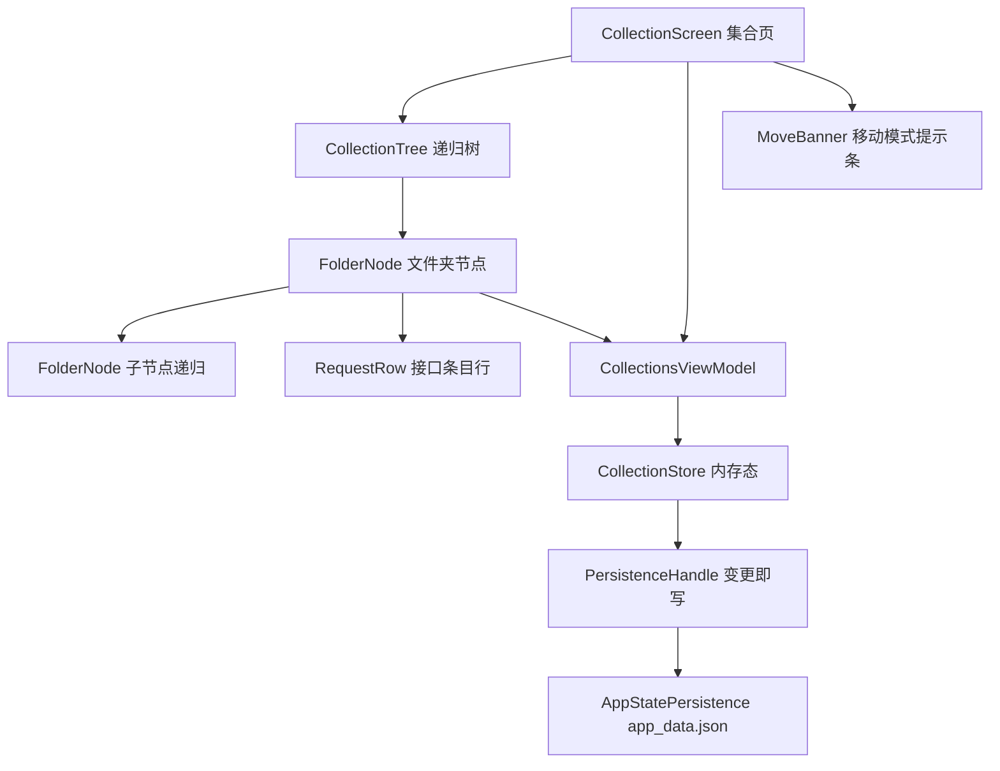
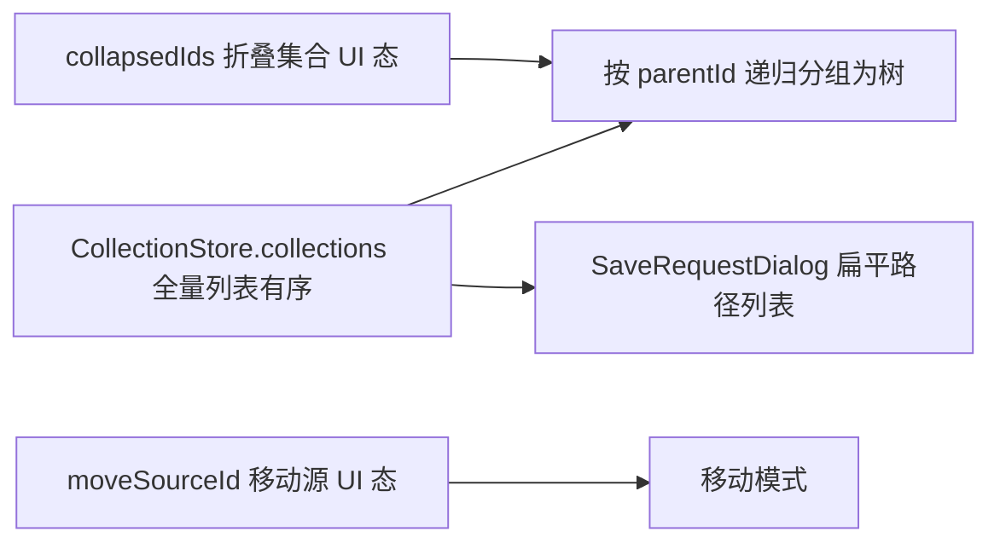

# 集合树形结构

Feature Name: collection-tree
Updated: 2026-09-30

## Description

把集合页从「项目 → 集合 → 接口」两级扁平结构改为无限嵌套的文件夹树。文件夹可包含子文件夹与接口条目，支持展开/折叠、新建、重命名、递归删除、移动。保存接口时的目标选择保持扁平下拉，但用完整路径区分层级。

数据模型只加一个可空字段 `parentId: Long?`，接口条目的 `collectionId` 语义不变（仍指向直接归属的文件夹），旧数据无需重建，按 `parentId` 缺失即根文件夹自动迁移。

## Architecture



### 状态划分



`CollectionStore` 继续持有**扁平有序列表**作为唯一数据源，树形只在展示层按 `parentId` 递归派生。这样排序、遍历、持久化、递归删除都作用在列表上，避免维护并行树结构导致的一致性负担。

## Components and Interfaces

### CollectionStore（`di/ServiceLocator.kt`）

在现有 `create` / `delete` / `deleteRequest` / `saveRequest` / `consumePending` / `snapshot` / `restore` 基础上调整与新增：

```kotlin
// 创建：parentId 为空表示根文件夹
fun create(projectId: Long, parentId: Long?, name: String)

// 重命名；空白名称直接返回
fun rename(id: Long, name: String)

// 移动：把 id 放到 newParentId 下；newParentId 为空表示变回根文件夹
// 目标是自身或自身后代时拒绝并返回 false
fun move(id: Long, newParentId: Long?): Boolean

// 递归删除文件夹及其全部后代与后代下的接口条目
fun deleteRecursive(id: Long)
```

派生查询（放在 Store 或单独 `CollectionTreeUtil`，供 UI 与保存对话框共用）：

```kotlin
fun childrenOf(collections: List<CollectionInfo>, parentId: Long?): List<CollectionInfo>
fun pathOf(collections: List<CollectionInfo>, id: Long): List<String>
fun descendantsOf(collections: List<CollectionInfo>, id: Long): Set<Long>
fun ancestorsOf(collections: List<CollectionInfo>, id: Long): Set<Long>
```

### CollectionScreen（`ui/collection/CollectionScreen.kt`）

拆为三层：

- `CollectionScreen`：持有 `collapsedIds: MutableSet<Long>`、`moveSourceId: Long?`、两个对话框状态；渲染 `MoveBanner` + `CollectionTree` + 新建入口。
- `CollectionTree(items, depth)`：递归主体，对每个文件夹渲染 `FolderNode` 并递归渲染其子文件夹与接口条目。
- `FolderNode(folder, depth, ...)`：单行 = 方向箭头 + 名称 + 新建子文件夹 / 重命名 / 删除。缩进由 `depth * 16.dp` 计算。

展开判定：`folder.id !in collapsedIds`。默认全部展开，切换项目时清空 `collapsedIds`。

### MoveBanner（`ui/collection/CollectionScreen.kt` 内私有 composable）

移动模式提示条：显示正在移动的文件夹名与「取消」按钮；移动被拒绝时短暂显示原因文案。

### SaveRequestDialog（`ui/collection/SaveRequestDialog.kt`）

下拉项由 `projectCollections.map { it.name }` 改为 `projectCollections.map { pathOf(collections, it.id).joinToString(" / ") }`，选中项的 id 传给 `saveRequest` 保持不变。

## Data Models

```kotlin
data class CollectionInfo(
    val id: Long,
    val projectId: Long,
    val parentId: Long?,   // null = 该项目的根文件夹；新增字段
    val name: String
)
```

- `SavedRequest.collectionId` 语义不变，仍为直接归属文件夹的 id，无需改动 `RequestType` / 各 Snapshot。
- `CollectionStoreSnapshot` 持有 `List<CollectionInfo>`，字段自动携带 `parentId`，无需改动。

### 持久化与迁移

`AppStatePersistence` 中集合读写各改一处：

- 读：新增 `JsonObject.longNullableValue(key): Long?` 辅助函数，`parentId` 缺失时返回 `null`，等价于根文件夹，即完成迁移；`CollectionStore.restore` 现有的「丢弃引用了不存在文件夹的接口条目」逻辑继续生效。
- 写：`put("parentId", c.parentId?.let { JsonPrimitive(it) })`，始终写出该字段，保证新旧版本往返一致。

## Correctness Properties

1. 扁平列表是完整偏序集：每个文件夹除根文件夹外恰好有且只有一个父文件夹，父文件夹必然存在于同一列表。
2. 不存在环路：`move(id, newParentId)` 拒绝 `newParentId == id` 与 `id ∈ ancestorsOf(newParentId)`，因此 `parentId` 链必然终止。
3. 引用完整性：任何 `SavedRequest.collectionId` 都指向存在的文件夹；`deleteRecursive` 同步清理被删文件夹集合下的全部接口条目。
4. 列表顺序即同级顺序：同级文件夹的显示顺序等于其在扁平列表中的相对顺序，`move` 把被移动项插入到新父文件夹同级列表的末尾。
5. 无孤儿文件夹：`parentId` 指向的文件夹被删除时，其全部后代一并删除，不产生悬空 `parentId`。
6. 迁移单调：旧数据经一次读写后 `parentId` 全部为 `null`，第二次读取结构不变。

## Error Handling

- 空白名称：`create` / `rename` 直接返回，调用方保持对话框打开。
- 重名：不做唯一性校验，允许同一父文件夹下重名（文件夹名不是主键，`id` 才是）。
- 移动到自身或后代：`move` 返回 `false`，`MoveBanner` 显示「无法移动到自身或其子文件夹内」。
- 跨项目移动：`move` 把被移动文件夹与全部后代的 `projectId` 改为目标所在项目。
- 递归删除：先收集 `descendantsOf(id) ∪ {id}`，再一次性过滤文件夹与接口条目，避免分批删除导致的中间态。
- 持久化写入失败：沿用现有策略，异常静默，下次变更重试。
- 折叠集合与移动源在数据变更后可能残留失效 id：`deleteRecursive` 后清理 `collapsedIds` 中的被删 id，`move` 后清理 `moveSourceId`。

## Test Strategy

无现有测试目录，沿用人工验证路线，按下列路径覆盖：

1. 升级验证：安装前已有旧版扁平集合，升级后全部显示为根文件夹，接口条目与顺序不变；重启后结构一致。
2. 树形展示：创建三级以上嵌套，检查缩进递增、箭头方向、折叠后子树完全隐藏。
3. 展开/折叠：点击箭头与点击名称均可切换；创建子文件夹后父文件夹保持展开；切换项目再切回恢复全展开。
4. 新建与重命名：空白名称不生效；重命名只改名称，子文件夹与接口条目保留。
5. 递归删除：删除含三级后代且处于折叠状态的文件夹，确认对话框中的数量与实际删除量一致；取消时数据完整保留。
6. 移动：把文件夹移动到更深的兄弟下；移动后目标父文件夹自动展开；尝试移动到自身与后代被拒绝且结构不变；跨项目移动后 `projectId` 正确；取消移动后结构不变。
7. 保存对话框：下拉显示完整路径且区分同名不同层级文件夹；选中子文件夹保存后接口条目出现在该文件夹下。
8. 接口条目：点击行切换协议 Tab 并恢复快照；行内删除只删条目不删文件夹。
9. 回归：集合数据的远程备份导出/导入往返后 `parentId` 保留。

## References

- `app/src/main/java/com/evan/pulse/data/model/CollectionModels.kt:7` - `CollectionInfo` 当前定义
- `app/src/main/java/com/evan/pulse/di/ServiceLocator.kt:370` - `CollectionStore` 当前实现
- `app/src/main/java/com/evan/pulse/data/persistence/AppStatePersistence.kt:110` - 集合读取
- `app/src/main/java/com/evan/pulse/data/persistence/AppStatePersistence.kt:280` - 集合写出
- `app/src/main/java/com/evan/pulse/ui/collection/CollectionScreen.kt:63` - 当前扁平卡片渲染
- `app/src/main/java/com/evan/pulse/ui/collection/SaveRequestDialog.kt:56` - 当前扁平下拉项构造
- `app/src/main/java/com/evan/pulse/ui/collection/CollectionsViewModel.kt:17` - 当前 ViewModel 转发

### 设计决策：移动用长按移动模式，不用 Compose 拖拽

已确认当前 BOM（2026.09.00）的拖拽 API 形态为 `Modifier.dragAndDropSource { offset -> DragAndDropTransferData }` 与 `Modifier.dragAndDropTarget(acceptsDrag: (DragAndDropEvent) -> Boolean, target: DragAndDropTarget)`。`DragAndDropEvent` 只有 `getDragEvent$ui()` 一个访问器，属于 ui 模块 internal，无法在 Kotlin 源码中取到落点坐标；`DragAndDropTransferData` 虽带 `localState: Any?` 但同样无法从 `DragAndDropEvent` 公开取回。

因此「拖到行的上半部插入为同级前项、下半部插入为同级后项」这类坐标判定在该 API 上不可实现。改为长按文件夹进入移动模式、点击目标文件夹放置，效果等价且符合 Android 文件管理器惯例。

拖拽带来的另一个代价：同级排序只能做到「插入到目标同级末尾」。如果后续需要精确的同级位置插入，改为自定义 `pointerInput` + `detectDragGestures`，用 `onGloballyPositioned` 收集每行矩形做命中判定。
