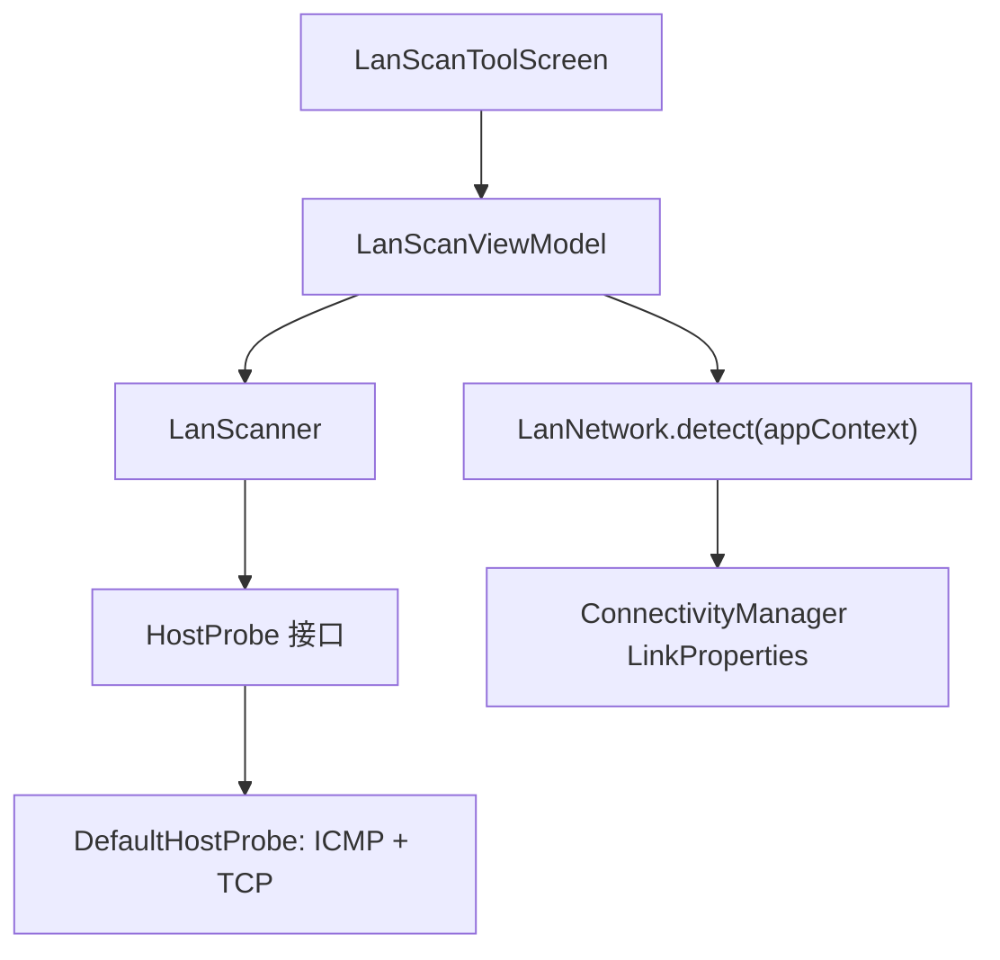

# LAN Scan Tool

Feature Name: lan-scan-tool
Updated: 2026-10-21

## Description

工具箱新增局域网扫描二级页：自动检测设备所在 IPv4 网段，并发探测全部主机地址（ICMP + 常用 TCP 端口回退），实时列出存活主机。沿用现有工具页模式（Nav 路由 + PulseApp entry + Dashboard 入口 + 三语字符串），扫描为会话内临时结果，不持久化。

## Architecture

纯逻辑（网段展开、排序、探测编排）放在 `domain/tools/LanScanner.kt`，通过 `HostProbe` 函数接口注入探测实现，单元测试用假探针覆盖；Android 侧只保留网段检测（ConnectivityManager）与默认探针。ViewModel 持有扫描 Job，停止与页面销毁通过取消协程实现。

## Components and Interfaces

- `LanNetworkInfo(ip: String, prefixLength: Int, hosts: List<InetAddress>)`：检测到的网段与待探测主机列表。
- `lanHostAddresses(address: InetAddress, prefixLength: Int, maxHosts: Int): List<InetAddress>`：纯函数；展开主机地址，前缀 < 31 时排除网络地址与广播地址，总量超过 `maxHosts` 时取前 `maxHosts` 个。
- `fun interface HostProbe { suspend fun probe(host: InetAddress): LanHost? }`：探测抽象，返回 `LanHost(ip, hostname?, latencyMs, probe)` 或 null。
- `DefaultHostProbe(icmpTimeoutMs = 300, tcpPorts = [80, 443, 8080, 22, 1883, 5555], tcpTimeoutMs = 250)`：先 `InetAddress.isReachable`，失败后并发连接常用 TCP 端口，任一成功即视为存活；主机名用 `getHostName` 容错获取。
- `LanScanner.scan(hosts, concurrency = 64, probe, onHost: (LanHost) -> Unit, onProgress: (scanned: Int, total: Int) -> Unit)`：Semaphore 限并发，可被协程取消。
- `LanScanViewModel`：init 时检测网段；`start()` 清空结果并启动扫描 Job；`stop()` 取消 Job；结果按数值 IP 升序维护。
- `LanScanToolScreen`：网段卡片 + 开始/停止按钮 + 进度与计数 + 固定高度结果 LazyColumn（沿用 MqttScreen 事件流模式）。

## Data Models

- `LanHost(ip: String, hostname: String?, latencyMs: Long, probe: String)`：`probe` 为 `"ICMP"` 或 `"TCP <port>"`。
- 网段展开上限 `LAN_SCAN_MAX_HOSTS = 512`；并发上限 64；ICMP 超时 300ms、TCP 连接超时 250ms。

## Correctness Properties

1. `lanHostAddresses` 对 /24 返回 254 个地址，严格排除网络地址与广播地址，顺序按数值递增。
2. 前缀 ≥ 31 时返回块内全部地址；总量超过 512 时恰好返回前 512 个。
3. 结果列表始终按数值 IPv4 升序，且同一 IP 只出现一次。
4. 停止扫描后已发现结果保留，pending 探测全部取消。
5. 任何单个探测异常不影响其他地址的探测，该地址视为不存活。

## Error Handling

- 网段检测失败（无 Wi-Fi / 纯 IPv6 / 仅移动网络）：显示本地化引导文案，扫描按钮禁用。
- `getHostName` 异常或超时：hostname 置 null，仅显示 IP。
- 探测中的任何 IO 异常：吞掉并记为不存活。
- ViewModel 清理：取消扫描 Job，引擎无应用级状态残留。

## Test Strategy

- 单测 `LanScannerTest`：/24 与 /30 展开、网络/广播排除、31/32 边界、512 截断、数值排序、假探针下的存活映射（ICMP / TCP 端口 / 不存活）、重复 IP 去重。
- 全量 Debug 单测 + Release 构建，核验版本、签名与根目录 APK 副本。
- 真机验证：ICMP 在不同机型的可用性、扫描耗时与 UI 进度（无法在沙箱覆盖）。

## References

- `app/src/main/java/com/evan/pulse/domain/tools/`（现有工具纯逻辑目录）
- `app/src/main/java/com/evan/pulse/ui/tools/CronToolScreen.kt`（工具二级页模板）
- `app/src/main/java/com/evan/pulse/ui/PulseApp.kt`（路由 entry 注册）
- `app/src/main/java/com/evan/pulse/ui/dashboard/DashboardScreen.kt`（工具箱入口）
