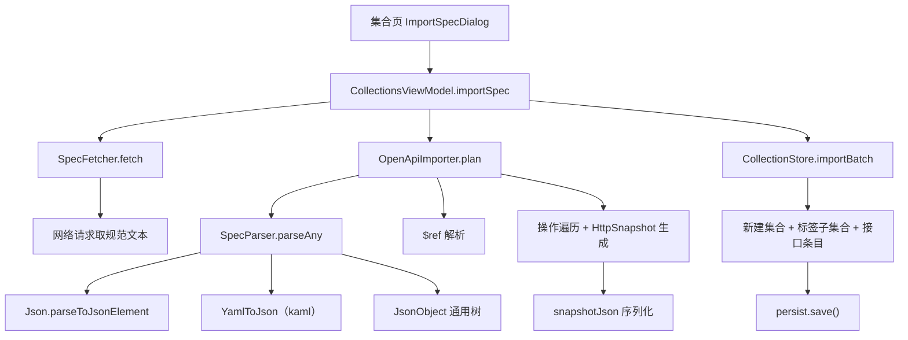

# OpenAPI / Swagger 导入

Feature Name: openapi-import
Updated: 2026-09-30

## Description

在集合页增加「导入」入口，把 OpenAPI 3.x 与 Swagger 2.0 规范（JSON 或 YAML）转换成一个新集合及其下的 HTTP 接口条目。输入支持两种方式：直接粘贴规范文本，或填写规范的 http/https 地址。

导入是单向的一次性动作：解析规范 → 生成导入计划 → 批量写入集合存储。导入后每条接口都是普通可编辑条目，与手工录入的条目无差别。

## Architecture



三层职责分离：

- `SpecFetcher`：只管把 URL 变成文本，不接触 OpenAPI 语义。
- `OpenApiImporter`：纯函数式解析，输入文本、输出 `Plan`，不接触 UI 与存储。便于测试与复用。
- `CollectionStore.importBatch`：只管落库，不知道规范长什么样。

## Components and Interfaces

### SpecParser

文本入口判别器。JSON 分支用 `kotlinx.serialization.json.Json`，YAML 分支用 kaml 解码为 `JsonElement`。

```kotlin
fun parseAny(raw: String): JsonObject
```

以首个非空白字符判断：`{` 或 `[` 走 JSON，其余走 YAML。JSON 解析失败或 YAML 解析失败时抛 `SpecImportException(SpecError.UNPARSEABLE)`，并带上底层异常信息。

### YamlToJson

kaml 解码到 `JsonElement`，支持 YAML 1.2 完整语义（含锚点 `&` 与别名 `*`，OpenAPI 规范里复用 schema 常用）。

```kotlin
fun toJson(raw: String): JsonObject
```

### OpenApiImporter

```kotlin
data class Imported(val name: String, val data: String)
data class Group(val tag: String, val items: List<Imported>)
data class Plan(val collectionName: String, val groups: List<Group>)

fun plan(raw: String): Plan
```

内部流程：

1. `SpecParser.parseAny` 得到 `JsonObject`
2. 校验 `paths` 存在
3. 计算基础地址（OpenAPI 3 用 `servers[0].url`，Swagger 2 用 `schemes[0]://host + basePath`，否则空串）
4. 遍历 `paths` 的每个键与 8 个方法键（get/put/post/delete/options/head/patch/trace）
5. 对每个操作组装 `HttpSnapshot`：地址、参数、请求体、认证
6. 按第一个 tag 分组，生成 `Group` 列表

`$ref` 解析只处理文档内引用（`#/` 前缀），按 JSON Pointer 逐段下钻；非文档内引用原样跳过。

### SpecFetcher

用 Ktor + OkHttp 发 GET 请求，15 秒总超时。

```kotlin
suspend fun fetch(url: String): String
```

非 http/https 地址抛 `SpecImportException(FETCH_FAILED)`；网络与超时异常统一映射为 `FETCH_FAILED`。

### ImportSpecDialog

`OverlayDialog`，内容分四块：来源选择（粘贴内容 / 从地址导入）、对应输入框、结果提示、`DialogActions`。

- 粘贴模式：`TextField(singleLine = false, maxLines = 8)`
- 地址模式：`TextField(singleLine = true)`
- 提交后在弹窗内显示「已导入 N 条接口到『X』」或错误原因，输入内容不清空

### CollectionStore.importBatch

```kotlin
fun importBatch(projectId: Long, collectionName: String, groups: List<ImportGroup>): ImportResult
```

一次写入：先建集合（单组时不建子集合，多组时每标签建一个子集合），再批量生成 `SavedRequest`，最后只调用一次 `persist.save()`。返回 `ImportResult(collectionName, requestCount)`。

## Data Models

### ImportGroup / ImportedItem

```kotlin
data class ImportedItem(val name: String, val data: String)
data class ImportGroup(val tag: String, val items: List<ImportedItem>)
data class ImportResult(val collectionName: String, val requestCount: Int)
```

定义在 `CollectionModels.kt`，与其他集合模型同处，供 Store 与 ViewModel 共享。

### SpecError

```kotlin
enum class SpecError { EMPTY, UNPARSEABLE, NOT_OPENAPI, NO_OPERATIONS, FETCH_FAILED }
class SpecImportException(val error: SpecError, override val message: String) : Exception(message)
```

UI 层按枚举映射到本地化字符串，`message` 作为补充细节。

### HttpSnapshot 字段映射

| 规范来源 | HttpSnapshot 字段 |
| --- | --- |
| `operation` 的方法键 | `method` |
| 基础地址 + path | `url` |
| `parameters[in=query, default]` | `params`（`enabled = true`） |
| `parameters[in=header, default]` | `headers`（`enabled = true`） |
| `requestBody` 媒体类型 | `bodyType` |
| `example` / `examples` / schema 骨架 | `bodyText`（美化 JSON） |
| `security` → scheme | `authType` / `apiKeyName` |

`params` 与 `headers` 为空时保留一条空 `KeyValueEntry`，与手工录入后的默认结构一致，`HttpViewModel.restore` 会补默认空行，导入端直接留空也可恢复。

## Correctness Properties

1. **路径不悬空**：每条生成的接口条目其 `collectionId` 必然指向本次导入新建的集合之一。
2. **一次持久化**：一次导入只触发一次 `persist.save()`，中途抛异常时集合存储状态不变。
3. **方法白名单**：只生成应用支持的 HTTP 方法；`OPTIONS`/`TRACE` 等不被 `HttpMethod` 支持的会被跳过。
4. **占位符不冲突**：应用占位符是 `{{var}}`（双花括号），OpenAPI 路径参数是 `{var}`（单花括号），两者互不干扰。
5. **round-trip**：每条 `HttpSnapshot` 经 `snapshotJson` 序列化后能再解码，字段值等价。
6. **幂等输入**：同一份规范文本两次导入得到相同集合名与接口条目名，数量一致。

## Error Handling

| 场景 | 处理 |
| --- | --- |
| 文本为空 | `EMPTY`，提示输入内容或地址 |
| JSON/YAML 都解析失败 | `UNPARSEABLE`，附底层异常消息 |
| 缺 `paths` | `NOT_OPENAPI` |
| `paths` 无操作 | `NO_OPERATIONS` |
| 地址非法或非 2xx | `FETCH_FAILED` |
| 请求超时（>15s） | `FETCH_FAILED` |
| 单个操作缺字段 | 跳过缺失部分，其余字段照常生成 |
| `$ref` 无法解析 | 跳过该参数或请求体，不中断导入 |
| `info.title` 缺失或空白 | 回退为「Imported API」 |
| 集合存储写入异常 | 向上抛，弹窗显示错误，输入内容保留 |

## Test Strategy

工程无测试目录与测试脚本，验证以编译与 APK 产物检查为准：

1. `./gradlew :app:compileReleaseKotlin` 无错误
2. `./gradlew :app:assembleRelease` 产物 hash 变化，`aapt2 dump resources` 出现新增字符串
3. 用三份真实样本手工验证：OpenAPI 3 JSON（含 `servers`）、Swagger 2 YAML（含 `host`/`basePath` 与 `$ref` schema）、含多标签与 `securitySchemes` 的 OpenAPI 3 YAML
4. 负样本：空文本、乱码文本、合法 JSON 但非规范（缺 `paths`）、不可达地址，逐一确认错误提示正确且输入被保留

## References

[^1]: (kotlinx.serialization.json.Json) - JSON 解析，见 `CollectionModels.kt` 的 `snapshotJson`
[^2]: (com.charleskorn.kaml) - YAML 1.2 解析，解码到 `JsonElement`
[^3]: (Filename#line) - `app/src/main/java/com/evan/pulse/data/model/CollectionModels.kt`
[^4]: (Filename#line) - `app/src/main/java/com/evan/pulse/di/ServiceLocator.kt`
