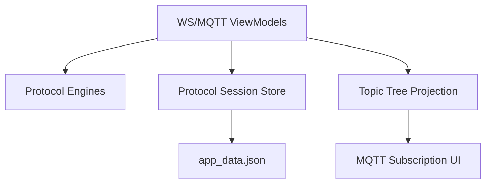

# WS / MQTT Enhancements

Feature Name: ws-mqtt-enhancements
Updated: 2026-10-21

## Description

Persist a bounded WebSocket event history and connection preferences, add opt-in automatic reconnect with exponential backoff, and persist MQTT subscriptions as a validated hierarchical topic tree. Preserve current protocol engines and local JSON persistence architecture.

## Architecture

ViewModels continue collecting engine events. A new protocol session store owns durable WebSocket lines and MQTT subscription entries, integrated with `AppStatePersistence` and backup/restore JSON. WebSocket retry orchestration belongs in `WsViewModel`, preserving explicit disconnect semantics and avoiding changes to the engine contract.

## Components and Interfaces

- `WsSessionEntry`: endpoint, event text, direction, and timestamp.
- `MqttSubscriptionEntry`: topic filter and QoS.
- `ProtocolSessionStore`: StateFlows and update/restore methods for bounded WS history and MQTT subscriptions.
- `WsViewModel`: persist collected events; keep the last successful config; coordinate cancellable retry jobs with exponential delays.
- `MqttViewModel`: validate MQTT filters; persist add/remove; subscribe all stored filters on every successful connect.
- `MqttTopicTree`: pure projection of saved filters to segment nodes and leaf entries; Compose renders collapsible branches.
- `AppStatePersistence`: add version-tolerant `wsSessionHistory` and `mqttSubscriptions` JSON fields; absent fields restore to empty values.

## Data Models

- `WsSessionEntry(id: Long, endpoint: String, text: String, isSystem: Boolean, timestamp: Long)`; retain newest 2,000 entries.
- `MqttSubscriptionEntry(topic: String, qos: Int)`; topic must be non-empty, QoS in `0..2`, `+` occupies a whole level, and `#` occupies the final whole level.
- MQTT tree nodes contain a segment name, child nodes, and zero or more exact subscription leaves.

## Correctness Properties

1. WS history is always bounded by 2,000 entries and ordered oldest to newest in the store.
2. MQTT topic-tree projection preserves every valid saved filter exactly once with its original QoS.
3. Every invalid MQTT filter leaves the saved subscription set unchanged.
4. WebSocket retry delays are monotonic non-decreasing and do not exceed the configured maximum.
5. Explicit WebSocket disconnect cancels all scheduled retry work.

## Error Handling

- Persistence parse errors follow the existing tolerant JSON restore behavior and default new protocol fields to empty collections.
- Invalid MQTT filters display localized inline feedback and do not call the engine.
- Retry connection errors become persisted system events; retry jobs stop when disabled, explicitly disconnected, or the ViewModel is cleared.
- MQTT resubscription failures remain visible through existing MQTT error events and do not abort other subscriptions.

## Test Strategy

- Unit-test MQTT filter validation and topic-tree projection, including root, shared prefixes, `+`, terminal `#`, and malformed wildcard placement.
- Unit-test WebSocket history trimming and ordering.
- Unit-test reconnect delay progression, maximum cap, reset after success, and cancellation on explicit disconnect.
- Run existing Debug unit tests and a Release build to verify persistence schema and localized UI resources.

## References

- `app/src/main/java/com/evan/pulse/ui/ws/WsViewModel.kt`
- `app/src/main/java/com/evan/pulse/ui/mqtt/MqttViewModel.kt`
- `app/src/main/java/com/evan/pulse/data/persistence/AppStatePersistence.kt`
- `app/src/main/java/com/evan/pulse/domain/net/KtorWsEngine.kt`
- `app/src/main/java/com/evan/pulse/domain/net/PahoMqttEngine.kt`
